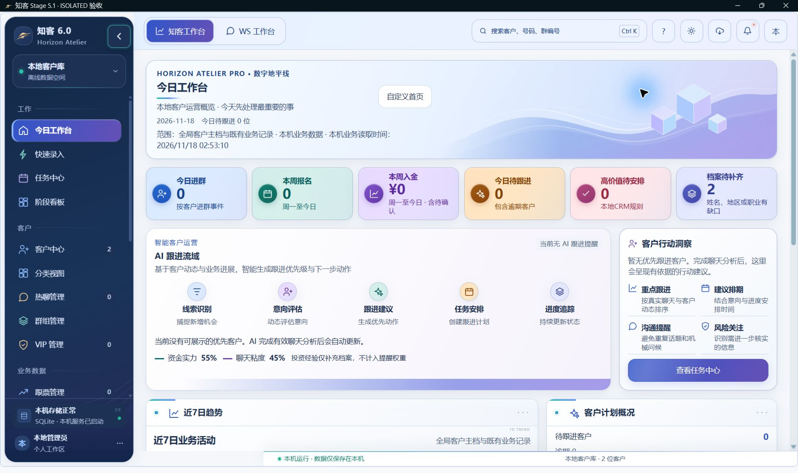
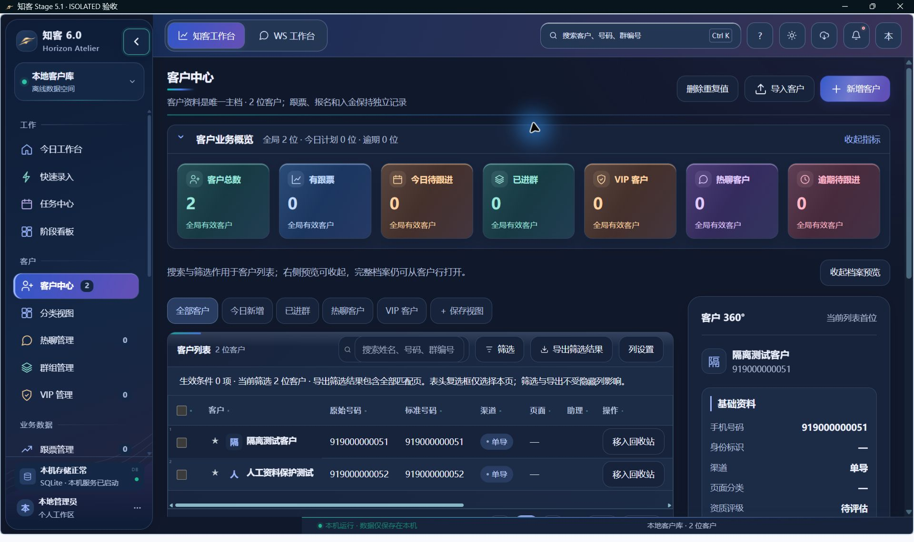

# V4.1 模块视觉与稳定性增量验收

2026-11-18。基线 `bca8813`，独立分支 `upgrade/v41-modern-integration`。用户允许参考图形、布局、字体和图标重做，明确要求保留业务逻辑关系与规则。本轮没有上线或发布；**S3 仍为 Blocked，生产入口 FROZEN**。

## 实际修改

|范围|实际完成|保留的行为|
|---|---|---|
|今日工作台|冰蓝紫波纹与立体几何图形横幅；六个现有 KPI 提至 AI 区域之前；指标、步骤、洞察使用各自色彩与图标；已确认的读取来源合并进横幅|KPI 仍由原指标投影提供；未加载/错误不假装为零；AI 空态、来源与读取时间保留|
|共享排版|正文、导航、表格、按钮统一 14px；页面标题 20px、区块标题 16px、KPI 26px，说明与徽标 13px；双主题共享资源复用|主操作区域保持 44px，不缩放整页或原生聊天容器；正文对比度仍至少 4.5:1|
|客户中心|七项真实业务摘要增加分别对应的 SVG 图标；摘要比例、间距与预览标题更紧凑|全部 count、筛选、去重、客户关联、读写动作不变；预览与完整档案原功能保留|
|WS 工作台|现有独立导航、工具栏、欢迎区域、业务入口与局部卡片对齐共享字号；不同模块使用蓝、青、紫、橙图标板|十二页导航、前台 WebView2、账号切换逻辑及 CRM 面板收起不变；不覆盖 WhatsApp 内部主题|
|GPT 页面|使用共享字号、标题和间距；附件操作高度补足 44px|配置、调用与业务流程不变，没有增加付费调用|
|隔离 WS 状态|隔离构建打开、探测、调整边界及隐藏时均明确报告「未连接」，不再对空白隔离文档做真实登录判定|生产构建的原登录探测与超时错误保留，未启用实际登录或采集|
|宿主线程与取消|既有桥接事件在 Dispatcher 回调内读取 CoreWebView2，消除回调前跨线程读取；已取消的登录探测交由桥接原有取消/超时路径处理，不再吞成「连接失败」|不重新创建 WebView2，不改变生命周期、权限或数据库服务|
|测试设施|源码读取统一 LF/CRLF；视觉合同对齐已实现的语义字号；身份探针最后一次查询完成后关闭|不删除测试，不延长 Edge 30 秒期限，不以进程强制结束充当正常通过|

本轮直接修改已有 CSS 所属规则，没有添加另一套主题或业务服务。图形使用原图标系统和内联 SVG，不增加动画框架或依赖。新视觉没有增加持续动画。参考图中的人数、消息、头像、在线状态、客户名称均未复制为正式数据。

## 业务规则不变的复核

`bca8813..4804e08` 的产品差异限于 `app.js` 的三个渲染函数、既有样式、WS 隔离状态提示和宿主线程访问。

- `app.js` 的 `renderHorizonHero`、`renderHome`、`renderCustomers` 更改展示；计数、首页投影、客户保存、业务动作处理器未改。
- 资金实力 55% + 聊天粘度 45% 的计算未改，投资经验仍只补充档案。
- CRM 唯一客户、证据门槛、人工字段锁、账号和群组身份范围未改；普通聊天 AI 没有获得未知客户建档权限。
- server、数据库 schema、最高 025 迁移、Feature Flags、Worker、IPC、fencing 和队列执行器无本轮产品变更。
- RD02 拦截仍在，未复制认证 profile，未恢复旧后台采集；现有生产开关继续关闭。

相关位置：`resources/app/app.js:425`、`:567`、`:725`；`modules/ws-workbench-core.js:294`、`modules/ws-crm-sync-core.js:267`、`modules/ws-group-monitor-core.js:93`；`LegacyUiHostPage.xaml.cs:853`、`:1115`、`:1862`。上述审查不替代真实平台能力验收。

## 测试及失败保留

执行目录为当前仓库；命令中的 `node` 指仓库 `resources/app/node.exe`，`dotnet` 指 `.tools/dotnet10/dotnet.exe`。所有业务测试使用隔离资料。

|本轮实际执行|结果与范围|
|---|---|
|共享 UI Node 专项|10/10；追加合同复核 3/3|
|`scripts/delivery/s1-main-visual.test.cjs`|Passed；实际完整 CSS，8 视口 × 20 路由，双主题及旧主题覆盖|
|`scripts/delivery/s1-ws-visual.test.cjs` 修正后专项|Passed；12 路由 × 7 视口/主题场景，20 次状态更新仍保持同一 host，顶部压缩精确 44px|
|`scripts/stage51/workspace-layout.test.cjs` 修正后专项|Passed；1920×1080、2560×1440，各 100/125/150% 的 CSS 等效视口，不冒充 Windows 原生 DPI 验收|
|`scripts/delivery/s3-customer-table-visual.test.cjs` 修正后专项|Passed；9 个正式场景及 1 个诊断场景，客户列表/抽屉/弹窗/键盘焦点/滚动/层叠/对比度验证|
|WS 隔离状态和 UI 线程合同|5/5；另已做真实 WinUI 局部复验|
|身份探针/生命周期|13 参数检查 + 13 受控子进程用例；传输 4/4，包含本轮晚退出故障的红/绿复现|
|完整回归首轮，代码 `5441eba`|**286/293，失败 7 项**。原始结果保留，不能用后续专项通过覆盖|
|完整回归第二轮，代码 `4804e08`|**292/293**；唯一失败为 `Delivery S1 actual main renderers and shared design system` 的 Edge 结果获取超时。首轮七项本轮均通过；不以独立专项覆盖此失败|
|上述第二轮中的 WS 子集|**162/162**；按相同 runner 的 WS 标签分类，取自此次真实全量结果，不是另跑一轮 WS|
|普通 WinUI Release x64|0 warnings / 0 errors，26.29 秒；`dotnet build desktop/src/Zhike.Desktop/Zhike.Desktop.csproj -c Release -p:Platform=x64 -r win-x64 --no-restore --nologo -v:minimal`|
|隔离 WinUI Release x64|0 warnings / 0 errors，26.24 秒；同上加 `-p:Stage51IsolatedUi=true -p:OutputPath=../../../.tools/stage51-native-v2/`，截图来自此构建|

首轮七项失败逐项保留并处理：

1. Local write flush、WS runtime resilience、S2 metrics projection：测试按 LF 多行字面量提取 CRLF checkout，未执行到目标断言。仅归一化测试输入，同一 Git blob 在 LF/CRLF 下对照验证。没有更改保存或指标业务逻辑。
2. WS UI 合同：原 16px 文本断言与本轮 14px 共享设计不一致；更新为明确的共享字号，44px 操作目标不变。
3. Stage51 layout：原判断假定 864px 高度必有导航滚动；紧凑导航已可全部容纳，现同时验证最后入口可达、overflow 为 auto，确有溢出时滚动有效。
4. S3 drawer：旧断言把 13px 的日期说明和状态徽标当作正文。精确区分这两个语义角色，其余正文仍至少 14px；4.5:1、44px 及全部几何断言保留。负控确认正文 13、说明 12、对比度 4.49、按钮 43 分别失败。
5. S1 WS Edge：30 秒总期限内，29.5 秒测试设施先关闭了身份探针，29.62 秒浏览器退出后末次身份核验被拒。修复探针关闭顺序，有实际受控故障复现；**不代表独立的历史 Edge `process-exit` 超时已修复**。详情见 [Edge 报告](v41-modern-edge-investigation.md)。

完整回归中 293 是 runner 检查项，不是内部断言总数；本轮增加既有测试内的状态/线程与晚退出案例，未删除 runner 检查项。

第二轮主渲染在初次 1280×720 调用中未交付结果，没有生成该次 `.result.json`，后续布局断言尚未运行。28.5 秒开始退出处理，已获 `Browser.close` 应答与 CDP 关闭；30 秒内仍未确认根退出/流关闭，探针退出状态为 unknown。具体等待点未确定，不能认定是某条 CSS 或新的视觉逻辑引起。事后只读检查的 4 个已观察浏览器身份与 1 个探针 PID 均不存在，不能覆盖原失败。详见 [独立失败取证](v41-modern-edge-investigation.md#最终集成回归的主渲染结果超时)。

本轮完整运行、专项与构建的源日志 SHA-256、脱敏摘录和逐项结果已归档：[运行索引](evidence/v41-modern-validation/runs.json)、[首轮全部结果](evidence/v41-modern-validation/full-regression.json)、[第二轮全部结果](evidence/v41-modern-validation/full-regression-r2.json)、[SHA-256 清单](evidence/v41-modern-validation/manifest-sha256.json)。结果摘录不包含 DOM、数据库或凭据；完整原始日志位于本地 `.tools/v41-modern/`。

## 真实原生预览与验证边界

本轮不是生成设计图。下面是实际隔离 WinUI 窗口截图，内有 2 条合成客户资料，不是真实业务。对照可查看 [上一轮浅色首页](evidence/v41-native/captures/02-home-light-maximized.jpg) 和 [上一轮深色首页](evidence/v41-native/captures/05-home-dark.jpg)；旧截图来自上一轮构建与不同合成数据，不能用于比较业务数量或性能。

已观察双主题首页、客户中心、WS 总览、聊天页、CRM 面板展开收起及聊天→总览→聊天往返。默认账号 Core 全程 generation 1，仅导航隔离 `about:blank`；状态「未连接」。正常退出后宿主与唯一隔离根的进程引用均不存在。截图、原始与归档 SHA-256、脱敏说明见 [原生复验](v41-modern-native.md)。

十次真实原生切号、全部页面/100%/150% DPI、实际滚轮、关闭动效、WS 长时负载未在本轮完成。当前平台/环境限制不能用浏览器合成矩阵替代。历史 WS 首轮启动异常的具体原始异常仍缺证据；本轮修复明确隔离状态契约，不能倒推历史全部异常已消除。

## 未完成项与安全

- 独立的 Edge 关闭应答后偶发进程退出超时仍为 Unresolved；最终全量还出现主渲染结果获取超时，具体等待点未知。测试工具探针竞态与两类未定位等待分别报告。
- 原生完整输入、账号切换与缩放矩阵尚未完成，当前截图仅证明所述操作范围；不宣布所有平台和业务验收通过。
- 隔离原生根 `zhike-stage51-native-2394f094d6b84d649699f60663203a66` 暂留，仅合成数据库与隔离 profile；未自动递归删除。最终失败浏览器根 `zhike-s1-main-style-ElGKTu` 和首轮失败根 `zhike-delivery-s1-ws-0qMTsW` 由既有安全清理机制保留，不以事后进程已退出覆盖原失败。
- 没有连接真实 WhatsApp，没有付费 AI 调用，没有打开正式客户 SQLite，没有执行生产迁移或新旧队列双写，没有制作或发布安装包。

原生截图可供视觉审核。**本轮视觉增量已实现，S3 仍 Blocked；生产 FROZEN，后续未验收能力不能自动上线。** 下一步是补完剩余原生验收并定位独立 Edge 退出阻断，不扩张业务规则。

## 提交与回滚

产品增量包含 `153d111`、`a13a1c5`、`545fbc1`、`5441eba`。测试设施修正最终代码基线 `4804e08`；文档和证据在独立提交中。最终报告提交及干净工作区状态在交付回复记录。

基线 `bca8813` 保留。需要回退时审查各提交后逆序 `git revert`，不覆盖未提交修改、不删除业务数据、不降级数据库。本轮没有 schema 迁移需要回滚。
