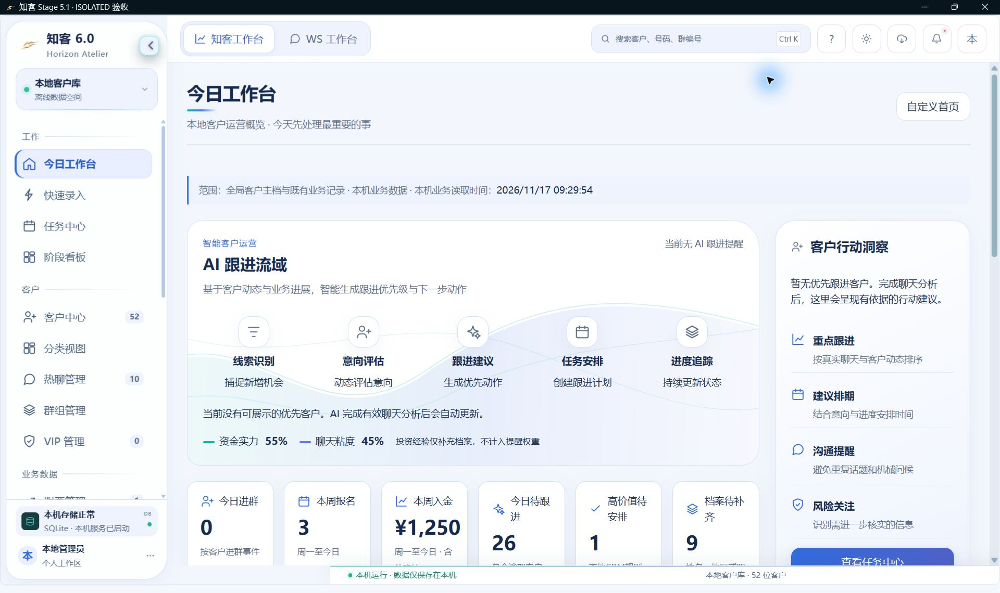
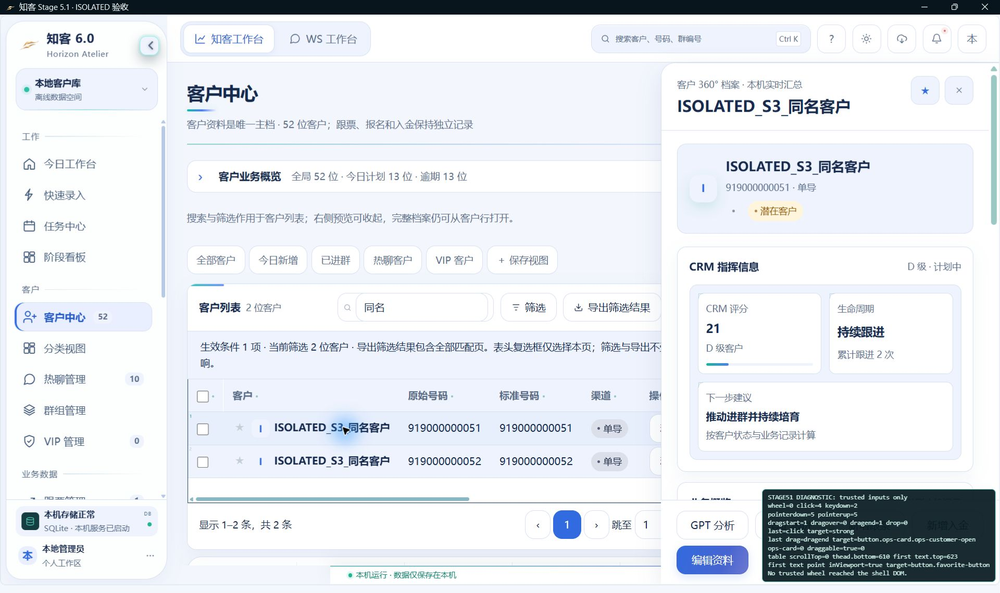
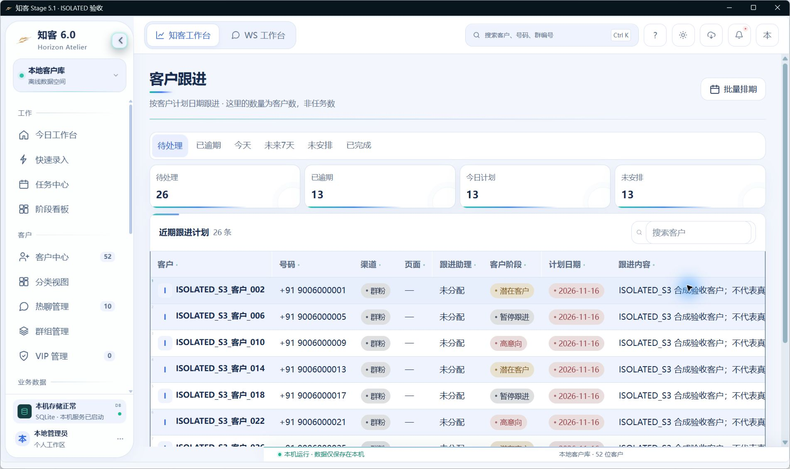
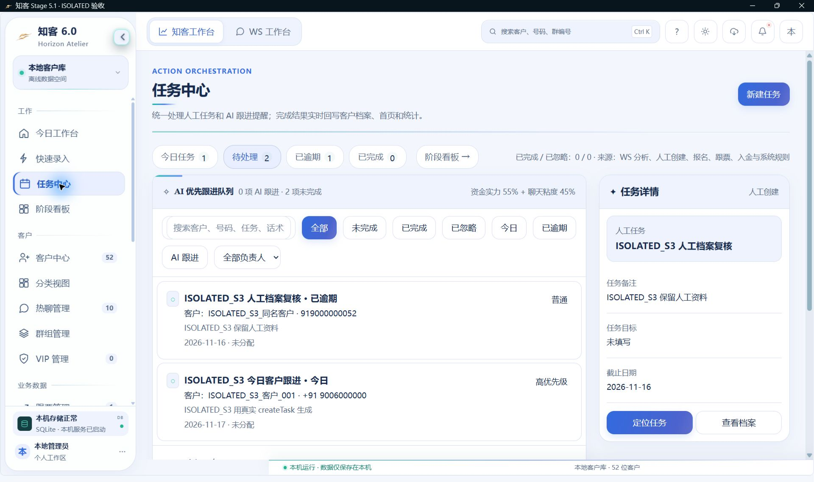
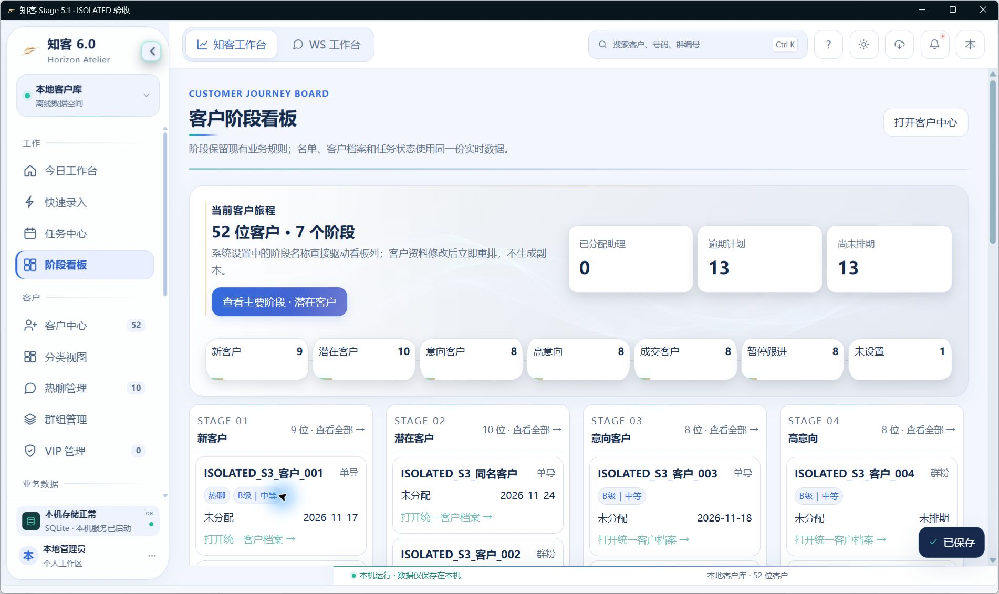
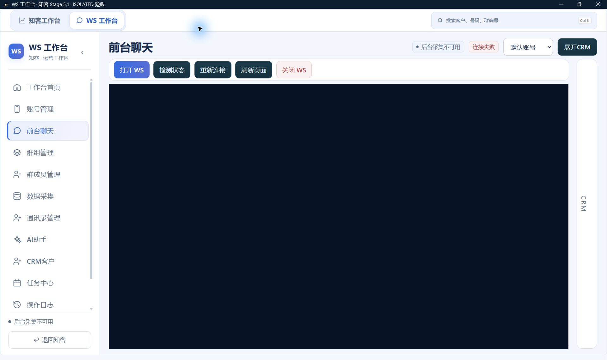

# 知客项目现状审核文档

用于审核现有项目、界面和模块，并收集下一轮修改与升级要求。

截至2026年11月17日（Asia/Calcutta），项目已具备本地客户业务、独立WS页面及受控Worker和AI基础设施，但尚未满足完整产品验收与正式发布条件。当前最重要的两个事实是：**最新完整回归仍有5项失败；旧WS后台采集已按安全决定停用，尚无已验收的替代能力。**

本文件记录仓库现状和此前隔离证据。6.0.3来自源码构建配置；本次没有检查已安装正式程序，也没有读取实际用户开关或账号登录状态，不能据此推断安装版本和生产配置与源码完全相同。

|项目|本次审核快照|
|---|---|
|产品代码及证据基线|`6befac01f1254f63047ec5977825004a991a48d3`|
|分支|`upgrade/zhike-61-ab-delivery`|
|正式构建版本|6.0.3；WinUI项目与本机资源包一致|
|升级目标|知客6.1 A+B；目标名称不等于正式版本已发布|
|界面品牌文字|仍有“知客6.0 / Horizon Atelier”，品牌和版本尚未统一|
|页面范围|22个主导航入口，WS内部12页，另有客户跟进兼容页；不把入口数量当完整功能数量|
|当前门禁|S3 Blocked；S0至S2已通过各自范围，S4以后未完成|
|生产状态|FROZEN；不批准真实WS、正式Worker或AI消费者、新旧队列双写或生产迁移|
|最新验证结果|项目全量286/291；其中WS段155/160；Release编译0警告0错误|
|本次整理方式|只读代码及已有报告、日志、实机截图；没有重新启动应用、读取生产数据库或运行产品测试|

## 01 审核结论和阅读方法

### 当前可以确认的进展

客户主档、跟票、报名、入金、VIP、热聊、群关系等既有业务继续存在。顶部双工作区、WS独立侧栏、部分统一设计系统已实施。S3修复了同名客户历史归属、跟进名单与返回路径、原生拖动和部分样式问题，相关真实操作已有记录。

Worker生命周期、Named Pipe身份边界、SQLite fencing、AI候选与CRM审核有真实代码与隔离证据。它们没有因此获得生产执行权限，也不证明WhatsApp平台端的历史、联系人、成员或发送回执均可取得。

### 审核时必须分开看三层状态

|层次|本文件如何表述|不能据此推导|
|---|---|---|
|实现|已有代码或服务、部分实现、尚未实现、未找到完整链路|有按钮不等于有后端，有表不等于有真实平台能力|
|验证|源码确认、自动化通过、有限原生通过、NotTested、Failed|编译或Mock通过不能替代原生交互、真实平台或干净设备验收|
|启用|本地已有业务、隔离测试、明确停用、生产FROZEN|隔离开关或历史任务不能解释为正式后台在运行|

### 请优先审核的差距

1. **WS采集目标尚未达成。** “扫码后不打开聊天就完整同步历史、联系人与实时消息”目前没有已验收的安全实现；已禁止复制认证profile，也不允许前台自动打开或滚动会话来冒充后台隔离。
2. **群系统边界不完整。** 当前有WS内群组/成员页与隔离服务；未找到独立群登录窗口和完整独立看群统计的端到端实现。“专用监测端口”应先明确为专用账号席位或窗口，不能与本机通信必须动态分配端口混为一谈。
3. **AI自动化仍受门禁限制。** 当前候选、审核、空字段与人工字段保护是正式代码规则；早期“全部自动补档无需确认”的目标不能当作当前行为。是否继续采用当前审核规则，需要你明确，不能直接绕过保护。
4. **扩展功能不应按页面数量认定完成。** 多账号自动群发、导入式群发、通讯录批量导入及多种群批量动作仍有缺口；详见F01至F14。
5. **换设备目标未完成验收。** 路径和动态端口已有基础，但加密zkdevice、完整媒体/账本迁移、可靠运行时部署、签名和干净Windows安装仍有阻断。
6. **外观不是全项目统一完成。** 当前浅色与深色并存，部分页面仍是旧布局；图标、品牌、字号、滚动、全DPI和所有业务页需要逐项复核。

### 既有跟进评分和资料规则

现有分析方向为资金资质55%与聊天粘度45%，必须依聊天证据及时间可信度处理，不能把推测当事实。股票投资年限属于档案资料，不应擅自纳入提醒权重。未知阅读状态不等于未读；客户VIP管理与WS监测群独立。普通聊天AI不能创建未知客户；已确认新入群后的受控建档由独立群服务负责，并先全局查重。

## 02 界面现状和实机画面

当前主工作区采用舒适浅色、蓝紫强调色，保留原深色调色板；主侧栏可以收起，WS有自己的侧栏。界面正处于逐页改造阶段，不能把早期深蓝预览图当作当前所有页面的实际样式。

以下全部是已经归档的实机记录，本次没有重新截取应用。**截图中的姓名、号码、数量和金额均为隔离验收资料，不是你的真实客户或业务业绩。** 每图说明验证范围；点击HTML里的图片可放大。

### UI01 今日工作台首屏

S3期间的真实隔离窗口记录。用于审核主导航、首屏和信息密度；不能由这一张截图推定所有后续细节均已验收。

来源：`docs/release/evidence/s3/native-home.jpg`。

### UI02 客户档案抽屉

真实客户档案与关联资料的修复后观察。截图中的资料是合成测试资料；稳定ID及同名客户的保护另有运行时证据。

来源：`docs/release/evidence/s3/native-drawer-refined.jpg`。

### UI03 客户跟进页面

最终原生复验显示待处理26、已逾期13、今日计划13、未安排13；这是该隔离样本的结果，不是你的生产统计。

来源：`docs/release/evidence/s3/native-followups-palette-final.jpg`。

### UI04 任务中心已有操作

实际人工任务完成后恢复的界面记录。该图早于新增完成率图，不应将它解释为新增图表已通过原生验收。

来源：`docs/release/evidence/s3/native-tasks-restored-source.jpg`。

### UI05 客户阶段看板

共享指针控制器的真实拖动及反向恢复后画面。新客户与潜在客户数量恢复；新增流转图在此截图中未展示，原生验收仍缺失。

来源：`docs/release/evidence/s3/native-shared47-stage-restored.jpg`。

### UI06 WS前台聊天区域

真实WinUI内的隔离WebView2容器。黑色区域为about:blank，不是已登录WhatsApp；本图只证明布局和“后台采集不可用”状态的有限观察。

来源：`docs/release/evidence/s3/native-final-compact-ws.jpg`。

### 界面审核时请逐项标注

|审核项|当前需要你判断的内容|
|---|---|
|UI07 布局与空间|首页是否保留折叠业务区，客户列表/档案宽度是否合适，哪些信息应放首屏|
|UI08 视觉与品牌|浅色/深色的默认方向、蓝紫强调程度、现有6.0文字、桌面图标与6.1品牌一致性|
|UI09 交互与滚动|外层与表格滚动、详情收放、键盘焦点、行操作、导航返回与窗口恢复|
|UI10 信息真实性|已加载范围、未知值、数据来源、采集停用、历史状态与实时状态是否清楚|

## 03 知客主系统逐页现状

### 主工作区外观和导航

当前有顶部“知客工作台／WS工作台”切换，主工作区保留原知客侧栏及四个分组：工作、客户、业务数据、系统管理。主侧栏可收起；页面计数来自本地业务状态。进入WS使用独立侧栏并在边界自动最大化，返回恢复原工作区与窗口状态，不新建主窗口。

已建立舒适浅色工作区与原深色调色板共存的设计系统，统一字体、按钮、输入、卡片、焦点、空态和错误态。首页、客户表格和档案、任务及看板已进入S3改造；其余页面多数保留原功能与旧布局，不能描述为“所有界面已统一完成”。大屏、多DPI、全部页面内外滚动及长时性能仍留待S7实际验证。

#### 工作

|编号与页面|现有功能及数据来源|当前验证范围和限制|用户审核时可提出的修改|
|---|---|---|---|
|M01 今日工作台 `home`|本地客户KPI、近7日本机日历日趋势、客户计划、业务活动、已记录的AI提醒入口、数据读取来源及时间。客户、跟进、报名、入金等来自同一主业务状态；AI提醒另经既有跟进提醒服务读取。完整业务区可展开；原首页局部面板可排序及保留布局。|S2只读聚合口径、缺失/错误/空态已有隔离验证。S3实际原生验证首页面板重排、刷新后保留以及进入26位到期客户名单。无AI结果时显示空态，不能把本地排序称为已调用AI。整体布局仍需用户视觉审核。|决定首屏保留哪些KPI、趋势和任务；是否继续折叠完整业务区；哪些动态应置顶；客户计划与真正任务的名称是否清楚。|
|M02 快速录入 `intake`|粘贴文本及CSV/Excel导入入口、智能整理、字段/默认值、逐行识别、去重、异常处理、确认入库。保存前通过原快照和主档写服务；默认值只填空，不创建第二客户库。|有现有实现和既有回归；本轮S3没有把整页重新设计并完成新一轮原生导入矩阵。号码规则仍是现有印度业务规范，不能升级界面时暗改。失败草稿保留、重复提交等场景需在对应页面升级时核验。|审核输入区与预览区的空间、错误行如何回改、字段映射展示、是否明确区分“整理”和“真正入库”。|
|M03 任务中心 `operations`|人工任务创建、编辑、完成、恢复，按今日/逾期/状态、来源、负责人和搜索筛选；AI任务完成/延期/忽略复用原跟进动作服务。来源与人工任务区分，截止时间不冒充最佳联系窗口；阶段预览及真实客户入口。新增只读完成率用原状态判定，全量已完成÷未完成与已完成之和，已忽略明确排除，零分母为空态。|S3人工任务完成、恢复和持久化有原生操作及只读回验。实际处理器专项最新51/51涵盖相关状态与保护，不等于真实AI质量验收。新增完成率图尚缺原生展示验收。AI生产消费者保持关闭。|审核人工和AI任务如何分区、优先级理由放在哪里、详情区域宽度、哪些动作必须先填写跟进结果；完成率口径是否符合运营需要。|
|M04 阶段看板 `stage-board`|列与客户阶段取现有设置，显示数量、占比、助理分配及计划状态；每列首80张卡，超出可打开完整名单。卡片开同一客户档案；拖动沿原快照、主档保存、日志与失败恢复。新增可展开“近7天已记录流转”，只计当前有效客户现存、时间与来源/目标均可验证的历史条目。|原HTML拖动曾被用户与原生测试证实不可用；已改为文档内指针手势，实际原生正向移动、反向恢复和保存反馈通过。稳定ID、同阶段不写、迟到事件与失败恢复有处理器测试。新流转图原生未验；已记录条目不代表平台完整历史或去重人数。|审核阶段顺序与卡片字段、是否优先显示待跟进信息、列滚动和完整名单入口；是否需要按负责人/渠道选择看板范围，不能直接改变阶段业务枚举。|

#### 客户

|编号与页面|现有功能及数据来源|当前验证范围和限制|用户审核时可提出的修改|
|---|---|---|---|
|M05 客户中心 `customers`|同一客户主档列表、搜索、排序、组合筛选、保存视图、列设置、分页、跨页选择、批处理预览、编辑、跟进、跟票/入金入口、软删除、按筛选或选择导出。客户概览默认折叠，列表优先；右侧预览可收起释放宽度，完整档案抽屉显示关联业务与历史。|S3修复同名客户报名历史误关联风险，使用稳定客户ID与迟到响应所有权，不按姓名猜客户；实际ID专项14/14。全CSS验证表头层级、清晰文字、夜色标签、抽屉底部44px操作及内容可达。原生有同名筛选、档案、一次合成跟进的观察；不能据此称每项编辑/权限/导出组合均已Native验收。|决定工作模式默认显示哪些列与概要、是否需要明确“工作／分析”切换（当前是概览折叠与预览收放，并非另一个独立分析页面）、档案分组、跟进时间线顺序及常用动作。|
|M06 分类视图 `segments`|对同一主档叠加渠道、页面、助理、群状态、阶段、热聊、VIP、跟票、入金、跟进和日期等条件；保存分类视图，钻取名单及导出。保存视图有作用域和相对日期语义。|功能现存，本轮尚未进入S4整页改造。需要继续核验相对日期、所有组合条件、视图命名与全量导出，不得只筛当前DOM页。|决定分类标签如何分层、默认视图、已用条件提示、如何区分具体渠道与“单导／群粉”大类。|
|M07 热聊管理 `hot`|在已有客户上标记/取消热聊，显示全部、今日新增、超过3天未跟进、未进群、未入金等列表；关联有效独立入金记录计算状态。|不另建客户，不因取消热聊删除聊天或业务记录。现有业务及回归保留，尚未完成S4视觉和本轮原生场景升级。|审核热聊认定、过期提醒展示、重点客户排序、未入金列表与档案的衔接；区分人工标记和AI聊天粘度。|
|M08 群组管理 `groups`|知客CRM群关系/逻辑群汇总、具体渠道分组、群编号、状态、搜索、分页及导出；结合已确认的进退群事件。它不是WhatsApp平台的进群、退群或踢人命令界面。|继续保留单导也需进群、FB群粉属于群粉且具体渠道不丢失的规则；今日事件与当前存量分开。待审核状态不算实际入群。新平台同步依赖WS授权能力，当前不能据此称实时监测已生产可用。|审核群编号、具体渠道与平台群JID的展示关系；现有客户关系与进退事件是否易理解；跨群客户如何查看。|
|M09 VIP管理 `vip`|为同一主档设置唯一VIP编号，按全部、今日新增、待跟进筛选，并复用档案和跟进入口。取消VIP保留客户及业务资料。|VIP客户属性与WhatsApp“VIP群”或被监测群无自动绑定关系；编号唯一约束保留。S4整页美化及完整原生冲突矩阵待做。|审核VIP等级/编号是否足够、是否需要服务内容或备注展示；任何字段扩展需另行确认，不应把本页变成WS群管理。|

#### 业务数据

|编号与页面|现有功能及数据来源|当前验证范围和限制|用户审核时可提出的修改|
|---|---|---|---|
|M10 跟票管理 `tickets`|客户关联的独立跟票记录，买入/卖出日期、产品、方向、状态；新增、编辑、导入、删除、筛选导出以及既有批量编辑/撤销。|同客户不同股票或不同交易日期必须保留多条记录，不能按手机号覆盖合并。现有后加载增强仍承担部分批量动作；S4整页升级未开始。|审核持仓/已卖出布局、关联档案入口、日期与方向列、批量修改预览和撤销提示。|
|M11 报名统计 `registrations`|独立报名记录与报名客户数分开，只有明确已报名计入；来源、负责人、搜索、分页、新增/删除及导出。|同客户可多次报名。已确认的现状差异是导出忽略页面报名来源/负责人/搜索，输出全部有效客户的已报名记录；不能称为“当前筛选导出”。改变口径需先确认。|优先审核“导出全部”和“导出筛选”的命名/范围；报名客户数与报名记录数如何并列，是否需要活动维度。|
|M12 入金管理 `deposits`|客户关联的多条金额、币种、日期、确认状态记录；新增、编辑、删除、筛选导出、既有批量编辑/撤销。|待确认不得当已确认。金额展示和多币种汇总仍需明确，默认金额显示与跨币种直接合并存在待审风险，不能凭当前数字宣称统一会计口径。S4尚未逐页升级。|审核币种、确认状态、金额精度、入金记录与客户余额是否应分开；图表是否按币种拆分。|
|M13 统计分析 `analytics`|本地客户、进退群、热聊、VIP、跟票和入金计数，具体渠道分布、现有漏斗样式及分类钻取；另有数据中心/运营增强的筛选与导出入口。|当前多数比率是有效客户总数分母的快照比值，不是同一批客户逐步转化的cohort漏斗。旧样式还对部分零值画最低正长度；全局报告和增强筛选导出范围不同。S2基础设施完成不代表本页已套用新口径/视觉。|审核每项指标的分母、日期、币种及来源；优先区分“快照分布”和“真实转化漏斗”，统一明细和导出范围。|

#### 系统管理

|编号与页面|现有功能及数据来源|当前验证范围和限制|用户审核时可提出的修改|
|---|---|---|---|
|M14 WS工作台 `ws-workbench`|主导航进入独立12页工作区，单独侧栏；前台真实WebView2容器，保留账号实例，聊天旁CRM可收起。返回主工作区复用原导航，现已修复从跟进页进入再返回时误回首页的问题。|具体页面见WS专章。RD02禁止认证profile复制和依赖该路径的旧隐藏采集，明确显示后台采集不可用，正常前台/手动入口保留。隔离about:blank和账号切换证据不能代替真实WhatsApp登录或收发验证。|优先审核聊天空间、账号与连接状态、工具可达性、WS十二页职责和与主客户档案的关系；安全替代平台能力须另行验证。|
|M15 GPT运营助手 `gpt`|对话/分析、来源范围、Provider/模型配置、连接/模型测试及现有管理计划预览/确认等接口；API Key复用原生当前用户DPAPI存储。|本轮不调用真实付费AI，也未启用新AI队列生产消费者。管理计划不等于自动执行；普通AI不得创建未知客户、覆盖人工字段或猜测客户身份。当前服务质量、503恢复与模型兼容须按真实授权另验。|审核对话、分析和可执行动作如何分开，结果证据、失败重试、成本提示、Key状态及管理操作确认。|
|M16 本地自动化 `automation`|本地规则开关、逾期/未分配/缺群号提醒、跟进模板、基于既有样本的助理建议及运营增强。某些建议需达到现有样本阈值，并经人工确认才应用。|本地规则不是已联网模型，也不代表平台自动群控或新Worker上线。关闭提醒应只影响提醒，不修改客户。S5尚未做完整设置与本轮原生联调。|审核规则说明是否直白、触发条件、最近执行/错误记录、哪些只能建议、哪些允许自动化；不要把“有按钮”当后台已运行。|
|M17 数据治理 `quality`|重复号码、重复VIP、无效号码、导入异常、复核标记/撤销；客户合并与专门治理API、审计及二阶段永久删除边界。|“标记已复核”不等于已修复数据；永久删除必须保留原确认/权限/快照保护，关联清理仍是需审查风险。S5未完成全部原生治理闭环。|审核质量问题优先级、证据和修复预览、合并差异、可撤销范围、危险操作隔离。|
|M18 数据中心 `data`|客户与各账号WS业务JSON导入导出、校验信息、快照、恢复差异、诊断、档案库摘要、模板与异常报告等现有入口。|现有JSON带完整性校验，不是加密`.zkdevice`设备迁移包；媒体文件字节和新增账本完整恢复尚不足，不能宣称换设备后所有业务已无损迁移。健康状态部分固定文案也需整改，不能充当实际Worker活体证明。|重点审核备份包含/不包含的内容、恢复预览、媒体覆盖、加密和新设备流程、失败后恢复路径。|
|M19 操作记录 `activity`|本地活动列表、搜索、导出，以及部分批量操作增强记录；原活动写入来自业务动作。|主页面目前展示近30条，本页搜索作用于所展示范围；导出则输出全部本地活动。它不是所有CRM/Worker/平台行为的完整统一审计。WS另有查询界面区分审计/快照/诊断。|审核检索范围、时间筛选、记录来源与对象跳转，明确“当前30条”和“全部导出”；是否要统一可追踪索引而非再建第二权威账本。|
|M20 回收站 `recycle`|客户软删除后查看及恢复，恢复时复用号码/VIP冲突检查；存在清空入口，沿现有快照与确认。|回收站不是安全可任意点击的普通展示。旧永久清空路径对任务、WS与群关系完整关联清理仍需检查，不能用“客户列表清空”代替无孤儿验证。未在本轮执行生产删除。|审核软删除和永久删除的区别、保留期、恢复冲突提示、受影响关联预览和权限。|
|M21 系统设置 `settings`|渠道/来源、页面、助理、群号、状态、阶段等选项；快照保留、清空密码、主题密度、菜单文案、头像、动效和工作区资料。|“本地管理员”及手机号登记里的角色不是已经实现的企业RBAC。选项重命名/禁用需保留原引用同步；密钥不应在这里另建存储。S1提供部分外观基础，S5的全部配置回归待做。|审核业务设置和外观偏好是否分开、危险设置分组、角色/权限真实能力、哪些配置应跨设备迁移。|
|M22 手机号登记 `phone-registry`|独立号码登记表，位置、编号、号码、所属角色、接码渠道；新增、内联修改、批量去重、Excel导入预览、导出及分页。|只改`phoneRegistry`，不会自动建立CRM客户或修改跟票、报名、入金。所属角色是业务登记属性，不是系统访问权限。S5待做当前原生导入/错误恢复矩阵。|审核列顺序、位置筛选、批量修改预览、重复号码处理及导入异常反馈。|

#### 兼容客户跟进页

|编号与页面|现有功能及数据来源|当前验证范围和限制|用户审核时可提出的修改|
|---|---|---|---|
|M23 客户跟进 `followups`，不单列主导航|从首页到期客户入口进入；待处理、逾期、今天、未来7天、未安排、已完成等页签，按客户计划查看并保留已有跟进历史/导出。复用原每页数量与分页，名称为“客户跟进”，与任务中心区分。|S3修复旧快捷入口误进受旧条件影响的客户名单、首100位限制及日期/导出不一致。263位到期客户全量可达有自动化验证；原生实际显示26/13/13/13统计及26位名单。配色与从WS返回原跟进页已实际复验。它不是第二套任务库，也不把一个客户计划当一个AI任务。|审核是否需要显式主导航、是否保留兼容页或整合到跟进工作区；如整合必须保留客户计划、历史记录与任务三者的差别及原导出。|

### 已打通的主业务关系

1. 客户中心、分类、热聊、VIP和阶段看板共享同一客户主档及稳定ID，不按显示姓名创建平行档案。
2. 一位客户可有多条跟票、报名、入金和跟进；业务记录保留各自ID、日期与字段，不因为号码相同互相覆盖。
3. 首页到期客户入口进入真实客户跟进范围；档案内可登记跟进并通过原写入服务保存，任务完成与客户计划不被简单混为一项。
4. WS明确关联到现有CRM客户后才能呈现主档；普通聊天AI只提出可验证候选，群组受控新成员登记由独立群服务负责，不让AI绕过此边界。
5. VIP管理与WhatsApp群监测独立；具体渠道、群粉归类、平台群JID与客户进群状态是不同概念。

### 本节源码依据和更新点

真实入口：`resources/app/index.html` 主导航，当前 `app.js` 的 `navNames`（101）、`renderHome`（565）、`renderCustomers`（722）、`renderIntake`（854）、`renderFollowups`（868）、`renderVip`（886）、`renderHot`（887）、`renderBusiness`（904）、`renderGroups`（977）、`renderAnalytics`（989）、`renderAutomation`（993）等实际函数。各页扩展仍由index后加载模块挂载，不应只检查`app.js`后就宣布该页功能齐全。

当前更新依据为 `docs/release/s3-core-pages-acceptance.md`、`rd02-authenticated-profile-acceptance.md`、`acceptance-matrix.md`、`business-contract-baseline.md`、`risk-register.md`；历史功能清单中的旧行号只作定位，不照搬旧状态。已校正两个重要旧描述：`followups`现在显示“客户跟进”且首页进入真实open范围；RD02之后不能再描述隐藏collector仍在正常采集。

本节没有新增、修改或删除任何产品业务功能；所有“待审方向”均等待用户审阅后另定实施范围。

## 04 WS工作台逐页和能力现状

### 当前可以怎样理解 WS 工作台

WS 已有十二个独立内容页面和自己的可折叠侧边栏。进入 WS 复用原知客主窗口并最大化，退出时恢复主工作区与进入前窗口状态；前台保留真实 WebView2 容器，切换业务页不应为每页重新创建聊天 Core。右侧 CRM/辅助区域可以收起，导入和本地消息区域也有折叠状态。

这些页面与本机服务确有业务接线，不能笼统说成“只有设计图”。但目前也不能称为“扫码后完整自动运行的云控系统”。最重要的当前事实是：**依赖复制已认证 WebView profile 的旧后台采集与群监测已经按用户批准的 RD02 停用，当前返回 `COLLECTION_CAPABILITY_BLOCKED`。** 前台连接状态与采集能力分别显示；前台显示已连接也不代表后台采集可用。不得通过打开旧开关恢复该复制路径。

当前保留正常前台聊天、手动切号、手动可见/选中文本导入及原业务资料/队列/断点。本轮前台生命周期证据来自隔离 `about:blank` 容器，不是已登录 WhatsApp 的聊天、收发、输入、滚动或翻译质量验收。正式 Worker、正式 AI 消费者、真实群监测/自动建档及生产队列切换继续 FROZEN。

### 十二个现有页面

| 编号 | 页面和路线 | 当前实际内容 | 数据和服务边界 | 验证状态与审核关注点 |
|---|---|---|---|---|
| WS01 | 工作台首页 `overview` | 已加载账号、会话、群组概况；历史采集状态、已加载跟进、AI 队列；进入聊天、各业务页及 CRM 审核的入口 | 复用本机 collection-runs、followup-alerts、ai-jobs 与当前账号目录；未知/未读取用“未提供”或“—” | 有真实渲染及隔离服务接线。不是实时平台总量；不能把历史状态或本机已加载数量标成全平台同步完成。后续可审核首页信息密度和优先入口 |
| WS02 | 账号管理 `accounts` | 添加本机账号、列表、搜索、分页、切换、连接状态和错误；账号所属数据分开 | Native 账号索引与 `/api/ws/accounts`；前台账号 Core 池复用，迟到请求按账号/代次隔离 | 有隔离创建/切号与十次交替选择的有限原生证据；没有真实多账号扫码验收。需审核账号命名、连接失败恢复、当前账号与后台能力的区别 |
| WS03 | 前台聊天 `chat` | 真正的 `#wsBrowserHost` WebView2；账号/连接工具条；CRM 可收起；导入/本地消息折叠；原回复、翻译、群发和导出工具入口 | 手动打开官方页面的原生宿主及既有 bridge；没有仿制聊天界面替换 WebView。前台不再承担旧历史滚动采集回退 | 隔离容器与 Core 复用已有证据，RD02 后状态条已压缩并释放聊天面积；真实 WhatsApp 登录、输入收发、媒体和内联翻译尚未验收。返回知客的实际按钮已修复为复用顶部工作区路由，可恢复跟进页 |
| WS04 | 群组管理 `groups` | 当前账号群目录、搜索、状态/权限/采集筛选、40条分页、复选、可收起详情；多选查看、复制 JID、清除选择；已有监测目标配置和历史 | 账号下已保存的群目录、配置、关系和进退事件；添加监测目标不等于加入群，停止监测不等于退出群 | 列表/作用域服务存在。RD02 已阻断旧真实群监测启动，不能称实时监控中。未知权限要显示未提供；复制 JID 不是提取群邀请链接。需审核群目录来源和监测不可用说明 |
| WS05 | 群成员管理 `members` | 成员搜索、所属群过滤、状态、管理员/角色、关联客户、详情、已加载进退事件 | `/api/ws/group-manager/members?limit=1000` 的独立群管理服务；明确 `accountId + groupJid + memberJid`；旧事件作为历史显示 | 新服务受隔离 Mock Gate 限制，生产未启用。当前客户端分页是在最多1000条已加载关系中操作，不是无限平台成员分页。不能按显示名合并跨群成员或将未知角色当管理员 |
| WS06 | 数据采集 `collection` | 历史任务、run/item、状态、错误、重试次数、断点/游标、历史覆盖数、任务历史和流程条 | 原 `ws_collection_runs/items` 及本机历史记录；当前任务最多读取1000项 | 页面和历史数据保留；新建、续采、补采、自动发现等动作被能力门禁拒绝/禁用，不启动另一个消费者。历史“完整聊天”标记依赖既有指纹/检查点，不能证明平台所有历史已取完 |
| WS07 | 通讯录管理 `contacts` | 当前账号查询、搜索、规范号码、号码状态、重复提示、CRM 关联、来源、详情、40条服务分页及加载/空/错误状态 | `/api/ws/workspace/contacts` 与 `ws-workspace-query.cjs`，只读投影本机已保存一对一会话 | 该功能有真实查询实现，不是完整 WhatsApp 联系人同步，也没有批量导入联系人执行链。未验证联系人不会自动写 CRM，`@lid` 缺号码不伪装为确认唯一。需审核“已同步”文案是否足够明确范围 |
| WS08 | AI助手 `ai` | 原分析摘要；任务队列、状态/失败、详情、来源证据、候选资料、取消/重试及原审核入口 | 阶段4统一 AI pipeline 与旧队列兼容路径；来源、身份、幂等与 fencing 边界复用 | 业务代码和隔离 Mock 集成已存在；正式 AI 消费者关闭，不能把 Mock 结果当分析质量。页面导航不应启动真实AI或擅自恢复队列。需审核任务详情是否能清晰区分候选、已审核及实际写入 |
| WS09 | CRM客户 `crm` | 当前账号明确关联的现有 CRM 客户列表、筛选、分页、只读档案；当前会话档案/资料补全；原候选审核、证据、冲突、批准/拒绝与审计 | 全项目唯一客户主档；会话显式 customerId 关联及原 CRM 权威服务，不另建联系人客户库 | 普通聊天只匹配现有唯一客户，不按姓名猜身份、不自动新建未知客户、不覆盖人工字段；候选通过受控服务审核后才写允许空字段。没有明确关联时应为空，不是去全库猜配对 |
| WS10 | 任务中心 `tasks` | 已加载跟进任务、搜索、状态/优先级、计划时间、原因、详情、失败、建议动作；进入知客任务中心 | 既有 followup-alerts 和任务服务；历史采集任务摘要与跟进实体分开 | 服务/页面存在；显示范围是当前服务已返回的数据，不代表所有未加载任务。此页不是第二套任务权威，不以打开页面启用自动AI。需审核任务来源及与主工作台衔接 |
| WS11 | 操作日志 `logs` | 时间、账号、类型、结果、来源、任务/对象过滤，分页、详情、关联链路及脱敏错误 | `/api/ws/workspace/audit` 聚合现有 `ws_group_audit`、`ai_task_audit`、`ws_send_audit`；另分运行快照 | 正式审计、运行快照、诊断文件明确区分，不新建第二套审计。诊断文件不通过该查询直接开放；快照不能冒充完整历史。需审核用户能否看清来源及覆盖范围 |
| WS12 | 工具与设置 `settings` | 翻译、群监测、GPT/API配置相关入口；手动导入/本地消息、导出、群发、清登录会话入口；FROZEN说明 | 复用既有工具和密钥服务；有些入口会回到聊天的辅助区，而非已有完整独立管理页 | “有工具入口”不等于对应完整管理中心。清登录会话是会影响授权状态的实际动作，不能作为普通刷新；现有客户业务保留。需审核哪些工具应做完整页面，哪些保持轻量设置 |

页面来源：`resources/app/modules/ws-workbench.js:16–30` 的 `WS_WORKSPACE_VIEW_META`；当前主体渲染在 `renderWsWorkspacePage`，约3323行；联系人/日志/成员/CRM/任务/断点明细在 `resources/app/modules/ws-business-pages.js`。页码、查询范围和状态来自实现，不来自早期设计图示例。

### 十四项扩展能力的现在状态

下表的“部分实现”指所列完整目标仍不完整，不表示其已有基础功能全是占位。按当前目标范围仍为部分实现6项、尚未实现8项；没有足够证据把其中任一项列为目标范围全部完成。旧盘点中的 R01–R09 需以之后的风险修复报告校正，不应重复列成未修故障。

| 编号 | 审核能力 | 当前分类 | 已有可复用范围 | 仍缺少或尚未验证 | 建议的审核决定 |
|---|---|---|---|---|---|
| F01 | 多账号群发 | 部分实现 | 当前账号、最多50个本地已读一对一目标；文本、图片/文件附件、caption、翻译预览、发送计划、逐目标/逐附件人工确认和审计；完整计划指纹与未知结果保护已加固 | 没有多账号后台编排/自动切会话发送消费者；没有可信平台接受/送达回执；不支持把群聊加入此一对一群发名单 | 明确保留人工模式还是另做安全可验证的自动化能力；独立群发中心是否作为完整页面 |
| F02 | 导入式群发 | 尚未实现 | CSV/Excel解析、列映射及现有发送计划可以复用 | 没有“导入名单→账号分配→可信会话匹配→逐行结果”的端到端流程；`/api/ws/import`是备份恢复，不是名单导入 | 先确定CSV/XLSX字段、收件人来源、已有/未知会话处理和退出名单规则 |
| F03 | 批量导入通讯录 | 尚未实现 | 现有只读联系人投影、号码规范化、原CRM导入和去重服务 | 没有WS联系人导入确认服务/批次审计/平台写联系人命令；CRM导入不能改名冒充WS通讯录导入 | 区分本地暂存、经CRM服务导入、写平台联系人三类目标，分别确认 |
| F04 | 批量进群 | 尚未实现 | 群目录、多选、监测目标配置、确认入群事件消费 | 没有真实加入/申请/邀请执行链、权限、结果和恢复；添加监测目标不是进群 | 明确“本账号加入”“邀请客户”“批准申请”是哪种；先验证接入能力再做按钮 |
| F05 | 批量退群 | 尚未实现 | 退群事件历史及停止监测 | 没有远程退出命令或平台结果确认；本地left状态不能当执行成功 | 明确账号、目标、权限、后果和不可自动回滚部分 |
| F06 | 批量移除成员 | 尚未实现 | 成员目录、身份/关系账本和已观察移除事件 | 没有真实移除命令、即时管理员资格检查、逐目标审计/未知结果对账；当前接入能力尚未验证 | 作为高影响群操作单独评审，不能由本地删除关系代替 |
| F07 | 批量禁言和开群 | 尚未实现 | 已有发言权限等只读字段 | 没有群发言权限写入与平台确认；“禁言/开群”具体语义也未冻结 | 先定义仅管理员发言/恢复全员，还是其它功能；验证权限和支持范围 |
| F08 | 批量设置管理员 | 尚未实现 | 角色/管理员只读展示 | 没有提升/撤销命令、授权、确认及恢复链，平台能力未验证 | 分清提升与撤销、当前管理员资格和逐目标结果 |
| F09 | 群邀请链接提取 | 尚未实现 | 可以复制群JID | 没有受权获取现有邀请URL、保护/导出服务；JID不是链接，也不能拿重置链接冒充读取 | 先确定仅提取还是还包括生成/重置，后两者影响旧链接，需要另行批准 |
| F10 | 个人素材库 | 部分实现 | 当前账号媒体上传、大小/基本类型检查、哈希、下载、引用、带墓碑保护的删除及图片/文件发送计划 | 尚无独立素材管理列表、分类、文本素材、版本、跨账号共享与完整生命周期管理；真实平台格式接受性未验 | 审核是否只做个人账号素材库、是否允许共享；不要取消原accountId隔离 |
| F11 | AI助手管理 | 部分实现 | AI Job/证据、CRM候选审核、GPT对话及现有Provider；队列查询/恢复职责已分开 | 没有助手实体/提示词版本/绑定/预算的完整管理；正式AI消费者未启用，真实模型质量未验 | 先明确助手配置与业务模板的目标，不另造AI队列或绕过CRM审核 |
| F12 | API Key管理 | 部分实现 | OpenAI与TeamoRouter两个Provider各一份当前Windows用户DPAPI密钥；保存/删除/状态/连通性入口；损坏、并发与切换竞态已加固 | 不是多Key池，没有Key ID、到期/轮换历史、逐WS账号分配和完整管理审计；跨设备不能复制DPAPI密文直接使用 | 先确认是否真的需要多Key；继续唯一密钥存储，不放业务SQLite或日志 |
| F13 | 翻译设置 | 部分实现 | 会话方向/目标语言/原文偏好、已导入消息翻译、译文保存、回复翻译预览与确认复制、群发翻译预览 | 完整独立设置页、账号默认继承、真实原生聊天内联联动未验；图片/文件caption与译文选择仍需清晰契约 | 确认翻译覆盖输入、收到消息、本地历史还是附件说明；不能把手动译文当原生全部聊天自动翻译 |
| F14 | 性能监控 | 部分实现 | 既有性能/健康工具、Worker状态查询、ProviderHealth、资源采样脚本和历史实测 | 尚无完整统一实时监控页/接口；历史采样和快照不是实时仪表；尚未完成S7的多DPI、大数据与长时预算验收 | 先确定启动、列表/图表响应、CPU/内存、Core/进程数和失败的具体指标，不显示固定“健康” |

这些新增能力的完整开发没有因为风险加固或界面重构而自动获得授权。现有路线没有证明任意扫码账号、任意既有群都可安全执行批量平台动作；本材料不对外部平台支持范围作新的承诺。

### 必须保留的业务规则与连接方式

1. **客户只有一套主档。** 普通一对一聊天AI只处理明确唯一匹配的现有客户，对允许空字段提出带证据候选，经过CRM权威服务才能受控写入；冲突/多匹配进入审核，不按显示名猜身份，不覆盖人工字段，也不创建未知客户。
2. **确认入群建档是独立服务权限。** 独立群管理中，只有可信“新进入且已确认在群”的事件，才允许按既有全局号码去重规则补建尚未录入的客户；申请/待审核不算入群。此服务有隔离业务实现，但生产未启用，RD02后旧平台监测也不可用。
3. **VIP客户与WS群没有必然关系。** 客户VIP编号/服务规则和WS监测目标独立。源代码中历史`configure-vip-groups`名称不应被解释为VIP客户必须属于某个监测群，当前该旧采集动作同样被阻断。
4. **同人跨群、跨账号按身份关联。** 群成员关系必须使用账号、群JID、成员JID；号码需要规范化和可信身份映射。相同显示名称不是合并依据。已知客户可有多个群关系，但不能建立第二套客户库。
5. **阅读未知不是未读。** Unknown不能计作Unread；指定消息已读统计必须有目标消息、成员范围及观察时间，不能拿部分返回行当全群完整阅读率。
6. **客户资质与聊天粘度是既有跟进方向。** 当前代码/分析应依证据，不把推测当事实；投资股票年限属于档案信息，不能擅自纳入提醒权重。新的评分和提醒规则需另行审核，不能由本状态文档直接改变。
7. **导出只覆盖本机已有内容。** 已有WS导出、导出任务与媒体索引服务，不等于能补齐未采集的平台全部聊天；联系人、群组、消息、分析/审计与媒体索引的导出和设备迁移也不是同一能力。当前完整媒体字节/新账本往返迁移尚有发布阻断。

#### 独立群组窗口和看群统计的缺口

当前已找到的原生窗口类为`MainWindow`，已有WS内群组管理、群成员页及隔离`group-manager`后端。此次在`desktop/src`与当前WS打开命令中**未找到独立WS群组登录窗口、独立原生群管理Window，以及完整独立看群统计页的端到端实现**。已有“独立群管理服务边界”不能直接写成“独立窗口已经完成”。用户先前提出的固定专用监测席位、独立登录、看群统计和消息阅读统计应单列审核，与现有普通聊天页区分。

### 发送结果应如何显示

| 状态 | 当前意义 | 不能推导的结论 |
|---|---|---|
| `local_attempted` | 已调用本地前台WebView发送动作，并有符合既有票据/前置校验的本地证据 | 不能显示成平台已接受或已送达 |
| `platform_accepted` | 需要可信平台接受证明 | 当前没有可验收的回执适配，不能由DOM点击/`ok:true`自动升级 |
| `delivered` | 需要可信送达证明 | 当前未证明能取得可靠送达回执 |
| `unknown` | 动作可能发生，但执行后中断、取消、失联、回包丢失或部分附件执行，无法确定结果 | 不允许自动盲重试，数据库回滚不能撤销平台动作 |
| `failed` | 明确的尚未执行前置失败，且没有历史未知或外部效果 | 部分附件已执行不能把整项降成“全部失败再重发” |

计划创建不等于发送。当前保留逐目标人工确认；调用API、生成计划、上传媒体、翻译成功、按钮点击成功这几个阶段必须分别显示，不能统一写“已发送”。

### 当前风险和证据口径

- `stage5-5c-feature-inventory.md`第6节R01–R09属于旧盘点风险；之后`stage5-5c-1a-risk-hardening.md`已记录在隔离环境成功复现并修复：计划指纹、计划/发送节流、附件未知结果、媒体/数据库一致性、24MiB本地契约、异步账号资格、AI查询副作用、DPAPI损坏并发与Provider切换竞态。不能继续把旧风险表直接当未修生产故障；也不能由其隔离Passed推断真实平台已通过。
- RD02代码`c970d40`禁止profile复制、隐藏采集与前台采集回退；9个实际链接Native服务案例、19个JS能力案例有通过证据。旧profile、客户、群组、消息、队列和checkpoint保留，未执行数据清理。
- 最后完整回归为286/291、5 Failed；其中实际`runWs`段155/160。失败涉及WS API/SQLite、媒体schema、广播、列表预览、跟进链，不能用更早160/160或完整290/290替代。部分原样单跑和API临时观测通过仍未证实全部失败根因。当前总Gate为Blocked。
- 十次WS切号的有限原生证据来自隔离空白页面；没有真实WhatsApp、真实翻译/付费AI、真实群成员变化或送达验收。较早两批默认配置宿主15/15已观察进程身份释放；最新宿主仅3个已记录root/sidecar/Core PID无活体，未取得完整退出前进程树。
- S3新增只读完成率/已记录流转图仍缺原生展示验收；与WS真实平台能力、跨设备安装、长时性能不是一项测试。

### 便于用户审核的优先问题

| 审核问题 | 当前事实 | 需要用户明确的方向 |
|---|---|---|
| 是否接受当前采集停用状态 | 安全禁用已实施；尚无获验收的安全后台替代能力 | 正常前台聊天优先，并单独决定后台能力探针/平台适配范围；不得恢复复制登录态 |
| WS独立导航怎样组织 | 十二页存在；部分工具仍跳转聊天辅助区 | 保留哪些一级页，群发/素材/翻译/导出是否升为完整页面；知客主导航不被WS替换 |
| 独立群系统是否单独窗口 | 未找到独立窗口完整实现 | 专用账号席位、是否独立进程/窗口、窗口与主CRM关系、群目录与统计范围 |
| 自动化应到什么程度 | 正式Worker/AI/群监测关闭，群发人工确认 | 哪些仅本地整理自动化，哪些涉及真实平台写操作须先验证及逐项授权 |
| 新一轮升级先做什么 | 最新回归仍5项失败，S3尚Blocked | 先解决可复现稳定性与现有验收，再选已确认的新功能；不要以增加按钮替代后端与平台验收 |

### 对应代码和文档

- 十二页导航与主体：`resources/app/modules/ws-workbench.js`，`WS_WORKSPACE_VIEW_META`、`renderWsWorkspacePage`、`refreshWorkspacePage`。
- 联系人/审计/成员/CRM/任务的页面与范围：`resources/app/modules/ws-business-pages.js`；查询：`resources/app/modules/ws-workspace-query.cjs`及`resources/app/server.mjs:2601`。
- 采集拒绝权威：`desktop/src/Zhike.Desktop/Services/WsCollectionCapability.cs`，Native动作前置门禁`Views/LegacyUiHostPage.xaml.cs:1116`；旧复制方法拒绝位于`Services/WebViewProfileService.cs`；调度在`Services/WsRuntimeService.cs`。
- 群服务、确认入群及CRM关系：`resources/app/modules/ws-group-manager-core.js`、`resources/app/server.mjs`的group-manager Gate/路由和既有群关系更新；生产默认关闭见`Services/WorkerFeatureFlags.cs`及`App.xaml.cs`。
- 发送：`server.mjs:4338`的计划、`:4420`的发送尝试/审计；`ws-workbench.js:createBroadcastPlan/sendBroadcastItem`；Native `WsSendOperationGuard.cs`与`LegacyUiHostPage.xaml.cs:1188–1463`的结果语义。
- 原功能盘点：`docs/superpowers/reports/stage5-5c-feature-inventory.md`。风险修复：`stage5-5c-1a-risk-hardening.md`。当前安全整改及最终结果：`docs/release/rd02-authenticated-profile-acceptance.md`、`s3-core-pages-acceptance.md`、`evidence/s3/full-regression.log`。

本材料中的可升级方向是供本次审核选择的建议，不构成新功能实施、生产启用、平台操作或数据迁移授权。

## 05 架构 数据 质量和发布现状

### 实际技术结构

| 层级 | 当前实现 | 负责的事项 | 当前边界 |
| --- | --- | --- | --- |
| Windows宿主 | WinUI 3，.NET 10，Windows App SDK 2.6.4 | 主窗口、标题栏、窗口布局、独立工作区、Native桥接、进程生命周期 | 当前TargetFramework为net10.0-windows10.0.22621.0；这不是已验证的最低Windows版本承诺 |
| 主业务界面 | WebView2内的本地HTML CSS JavaScript | 知客主导航、CRM、业务数据、设置、图表 | 现有业务增强模块仍有DOM选择器和标题文本挂载，未完成全仓解耦 |
| WS前台容器 | Microsoft.Web.WebView2 1.0.3719.77；按账号的会话池 | 知客内正常显示官方WhatsApp Web，保留账号容器、前台切号与聊天区域 | 本轮有限原生验收使用about:blank；不能据此证明真实WhatsApp登录和收发 |
| 本机sidecar | 随包Node 24.22.1与server.mjs | HTTP业务接口、SQLite、客户/WS服务、导出、迁移和受控写入入口 | 正常WinUI路径使用动态loopback端口与本次token，不是依赖固定开发端口 |
| SQLite与版本迁移 | node:sqlite、migration-runner.cjs、004至025迁移 | 主客户资料、WS账本、AI结果、审计、快照 | manifest最高schema 25，共22个SQL迁移；历史checksum不可随意修改 |
| Worker控制层 | WorkerRuntimeController、WorkerSupervisor、WorkerFeatureFlags | 启停、心跳、超时、取消、恢复、token轮换、进程观测 | 正式Supervisor创建参数Enabled:false；缺配置或非法配置的开关均默认关闭 |
| Worker IPC | Named Pipe、当前用户SID/ACL、版本化封包与HMAC proof | WinUI与受控Worker之间的身份、请求、会话和消息边界 | 既有实际实现及历史跨SID证据保留；本次文档整理不重新验收跨SID |
| 受控写入协调 | sidecar-write-coordinator.cjs与fencing gate | 持久租约、单调fencing token、事务校验、幂等事实和checkpoint | 只适用于接入该协调者的受控路径；不能声称全部旧业务接口已天然被新Worker接管 |

当前没有引入第二套Web前端框架或第二套CRM客户库。图表主要复用本地SVG和CSS/HTML渲染，S2/S3复用只读指标与图表模块；不是新的商业BI系统。

### 数据权威和存储范围

| 数据类别 | 当前存储和权威 | 主要限制 |
| --- | --- | --- |
| CRM客户主档 | SQLite的app_state保存业务工作区JSON；同一writeState事务维护customers索引和data_json | customers不是另一套独立可写客户库；所有增强页面仍须沿既有写服务同步，不能直接写单表冒充成功 |
| 客户身份 | 稳定customer ID、规范化号码、active号码唯一索引、crm_identity_conflicts冲突记录 | 显示姓名不是身份；相同号码的有效客户全局去重，未知或冲突身份不得靠AI猜测 |
| 跟票 报名 入金 跟进 | 当前CRM工作区内的独立业务记录，按customerId关联 | 同一客户可有多笔记录；不能因客户唯一而合并不同股票、日期、报名或入金 |
| 手工任务 | settings.operatingTasks | 与AI来源任务的动作服务不同，不能一律标作AI任务或直接修改AI任务状态 |
| WS会话 消息 翻译 分析 | ws_accounts、ws_conversations、ws_messages、ws_ai_analyses、ws_replies等账号作用域表 | 账号范围不可省略；联系人目录和本地缓存不等于平台完整通讯录与全部历史 |
| 旧采集任务和提醒 | ws_collection_runs、ws_collection_items、ws_followup_alerts及checkpoint | 历史数据保留。只读Worker适配层不代表新消费者已切换；RD02后旧认证复制采集路径不可再执行 |
| 群目录和关系 | ws_group_catalog、监测配置/事件/checkpoint；customer_group_memberships关系账本 | 关系键包含accountId、groupJid、memberJid；客户JSON内群关系是兼容投影，不应另立权威 |
| 新独立群管理账本 | ws_group_members、ws_group_sync_runs、ws_group_messages、ws_group_read_evidence、ws_group_sync_errors、ws_group_audit | 当前受功能开关与隔离Mock Transport边界限制；表和服务存在不代表真实群平台能力通过 |
| 新AI流水线 | 复用ai_jobs；ai_crm_suggestions、ai_job_evidence、ai_task_audit记录候选、证据和审计 | 正式消费者关闭；Mock输出不能作为真实AI分析质量证明 |
| 媒体和发送 | 媒体文件与ws_media_assets索引、ws_send_attachments、ws_send_audit、ws_export_jobs | 数据库引用与文件须一致；平台送达状态不能从本地点击推断；完整设备恢复仍有覆盖缺口 |
| API Key | Native AiBridgeService使用当前Windows用户DPAPI加密，保存在独立凭据配置 | 不向页面返回明文，不作为业务数据库字段，不应随设备迁移复制DPAPI密钥 |
| 登录态 日志 缓存 备份 | 正常数据根使用Windows LocalApplicationData下Zhike6，分别由Native服务管理 | 本次没有读取真实profile或密钥；新设备应重新扫码、重新配置自己的AI Key |

当前普通聊天AI的客户边界是：唯一可信地关联到已存在的客户，基于可验证来源提出候选，只补允许且空白的字段，不覆盖人工值；多客户、身份不确定或字段冲突进入审核。普通AI不能创建未知客户。独立群管理器经验证入群、全局号码去重后的受控登记是另一项服务权限，不能被普通聊天AI借用；待审核入群不算真实入群。

### 主要业务数据流

**本地CRM流程**：知客页面操作 → 既有业务校验和快照/版本检查 → Native桥或本机API → 同一客户工作区writeState → app_state与customers索引一致更新 → 原页面和关联业务重新读取。S3修复了同名档案历史归属、跟进入口范围和返回路径，没有改成第二套客户数据。

**前台WS流程**：选择当前账号 → Native会话池复用该账号WebView2 → 官方前台会话容器显示 → 用户手动操作。普通页面切换不应重建聊天Core。该容器仍受账号generation和发送资格检查保护；本轮只能证明隔离容器与有限切号/布局动作。

**历史采集与新受控路径**：旧任务和历史检查点继续可读 → 只读队列适配产生稳定Job映射 → 只有明确开关和租约资格满足时，隔离Worker路径才可执行 → 提交时事务内验证fencing → 业务事实和checkpoint共同提交。正式消费者未切换，新旧队列没有获准并行写入。

**AI与客户补全流程**：已采集且授权的来源 → AI Job → 可替换Provider → 结构化结果、来源证据和候选 → CRM权威匹配/人工字段保护 → 审核/受控空字段更新 → 审计 → 现有跟进任务和工作台。该流程有代码与隔离验证，不等于正式AI消费者当前在持续运行。

**群管理流程**：账号与指定群 → 可信成员身份和确定性入退事件 → account/group/member关系账本 → 全局客户去重 → 符合规则时受控登记或更新关系 → 事件和审计 → 统计数据来源（独立窗口及完整看群统计前端尚未完成）。阅读状态Unknown独立保留，不能当作Unread；VIP客户管理与WS监测群不互相推导。

### 已经保持的安全边界

1. RD02已按用户批准实施：不复制认证profile，不创建旧隐藏collector，不在前台注入历史滚动采集回退。相关入口在任何profile文件IO前明确拒绝。
2. 前台连接状态与后台采集能力分开。当前能力DTO明确backgroundCollection、automaticHistory、groupMonitoring、foregroundFallback均为false，manualVisibleImport为true。不能因为前台显示连接成功就显示后台采集运行中。
3. Worker、群管理、AI流水线开关缺失、损坏、未知schema或缺字段时默认false。正式Supervisor仍禁用，本次未改生产配置。
4. IPC的会话/request ID/协议、SID/ACL、token、取消和超时边界继续复用。fencing在SQLite写事务内复核owner、token和租约时效，过期Worker不能提交受保护结果。
5. 人工字段、客户唯一匹配、账号与群关系隔离规则继续保留；未授权的平台批量操作不能由UI入口代替权限验证。
6. 发送结果至少区分本地尝试、平台接受、送达、结果未知和明确失败；未知结果不能自动盲重试。当前本轮未证明真实平台送达。
7. 本轮未读取或迁移生产SQLite、未登录真实WhatsApp、未启动正式Worker/AI、未开启新旧双写。测试证据使用隔离合成资料。

### 当前质量证据和不能推导的结论

| 项目 | 最新可引用结果 | 结论边界 |
| --- | --- | --- |
| 正式WinUI Release x64 win-x64编译 | 0 warnings，0 errors，26.06秒 | 编译成功；不是业务全部通过或安装包可分发证明 |
| 最终项目全量 | 286/291 Passed，5 Failed，exit 1 | 当前回归门禁未通过，不能拿历史290/290替代 |
| 该次完整回归内实际WS段 | 155/160 Passed，5 Failed | 是本次all执行内的WS范围，不是另一次独立WS全绿命令 |
| S3实际事件专项 | 51/51 | 覆盖阶段/首页指针和只读图表边界；不等于全部原生交互 |
| 客户身份专项 | 14/14 | 同名、稳定ID、迟到响应和失效归属的隔离事件证据 |
| RD02专项 | Native路径9/9；JS能力19/19 | 安全拒绝和正常前台边界的有限验证，不是后台采集替代方案或真实WS收发证明 |
| 原生已完成 | 看板阶段正反拖动、首页重排与刷新保留、26位跟进跳转、新配色、从WS返回原跟进页 | 仅覆盖记录的真实动作和合成数据 |
| 原生未完成 | 新增任务完成率、近7天已记录阶段流转两图 | 桌面工具报窗口捕获错误，NotTested；不能用Mock或截图设计补为Passed |
| 进程退出 | 较早两个默认配置宿主各15/15准确身份释放；最终由用户正常关闭宿主后，3个预先记录PID未发现活体 | 最新一次没有完整退出前进程树采样，不能写成全树全部通过 |
| 性能与DPI | 有局部原生资源快照、真实全CSS有效视口验证；仍有大库冷聚合和历史扫描成本待测 | 不能据工作集单点或Edge视口宣称无泄漏、全DPI通过、所有页面不卡顿 |
| 诊断归档 | 153份证据加2份SHA清单，归档和暂存Git字节校验一致 | 证明证据完整性，不会把失败转为成功 |

最终5项失败是WS API/SQLite、WS导出媒体schema、广播翻译发送审计、会话列表预览更新、跟进链。原样单跑API仍出现失败，其余4项通过；临时加入诊断的API六次均通过，未捕获失败原因。schema夹具finally可能覆盖原异常，广播退出等待有同步风险，但尚未证明它们就是本次历史失败根因。原超时和断言没有被放宽。当前应记录为“失败且根因待确认”，不是直接给生产功能定性为损坏，也不能宣称问题已修。

### 数据迁移 备份与跨设备运行

| 能力 | 当前状态 | 尚需完成 |
| --- | --- | --- |
| 安装目录与用户数据目录分离 | 正常启动代码已动态定位AppContext资源和LocalApplicationData数据根 | 仍需不同用户名、盘符、安装位置、普通权限的正式包实测 |
| 动态端口 | WinUI本机服务通过loopback端口0分配可用端口，配置本次token与父进程 | 不能把server独立开发入口默认4173误报为正常桌面固定端口；端口冲突/恢复继续验收 |
| 首次空库初始化 | 有初始化和Migration Runner代码及隔离证据 | 不能替代无源码、无开发工具干净设备的首次安装验证 |
| SQL版本迁移 | manifest支持schema25；迁移前校验、备份，逐版本事务，失败回滚当前版本 | 不是整批全有全无；早期已提交迁移不自动撤销，完整旧版恢复流程需演练 |
| 历史024 checksum | 有明确历史兼容分支，校验schema、备份和兼容审计；本轮回归覆盖 | 不能静默忽略未知checksum或直接覆盖历史迁移记录 |
| JSON备份与快照 | 已有SHA-256完整性封装、备份容量上限和CRM快照 | SHA不是加密；CRM快照不包含全部WS表与媒体字节 |
| 加密zkdevice设备迁移 | 当前未找到完整实现或完成证据 | 需加密格式、完整表/媒体清单、导入预览/校验、失败恢复及新设备重授权 |
| 全量恢复往返 | 当前导出与恢复覆盖有差异 | 发送审计、媒体、新群管理/AI账本需逐项对账；不能丢失unknown发送墓碑后盲重发 |
| 正式通用安装包 | 有现有打包/安装脚本，不是本轮已验收新包 | 资源依赖闭包、最低Windows、WebView2 Runtime部署、签名及失败诊断 |
| 跨设备正式验收 | 当前没有完成干净Win11与Win10设备的整套证明 | 安装、启动、WS重新授权、本地业务、升级、卸载、保留数据、回滚、离线恢复均需记录 |

### 需要审核的主要风险

| 编号 | 优先级和当前状态 | 审核时应理解的影响 |
| --- | --- | --- |
| RD01 | P0 静态发现未排除 | 正式打包白名单缺migration-runner.cjs，源码能跑不代表新bundle依赖完整；必须用实际bundle启动验证 |
| RD02 | P0 安全整改已提交 最终验收仍Blocked | 旧认证复制采集已封锁，用户数据保留。需要安全、可授权的平台替代方案；不能回滚重新复制登录态 |
| RD03 | P0 未完成 | 现有明文JSON加哈希不是加密设备迁移包；用户换设备的完整迁移目标尚未达成 |
| RD04 | P0 未完成 | 导出和恢复数据/媒体覆盖不完整，不能称全部资料可完整迁移恢复 |
| RD05 | 发布阻断 未验证 | 需要明确受支持的最低Windows版本，不能直接把Windows SDK目标值当实测兼容承诺 |
| RD06 | 发布阻断 未验证 | WebView2缺失时现安装器主要引导下载，可靠安装/检查/重试流程尚未完成目标机验收 |
| RD07 | P0 状态真实性待改 | health部分固定healthy/running与正式Worker禁用不一致，不能将它当数据库完整性或Worker活体证明 |
| RD08 | P0 门禁复核待完成 | 正常sidecar继承父环境，未明确剔除测试AI/群/fencing变量；是静态风险，未证明真实用户配置已受影响 |
| S3回归 | 当前明确阻断 | 最新全量5项失败，必须先找原因并完成必要修复和整套重跑 |
| S3原生 | 当前明确阻断 | 两项新增只读图表仍缺原生验收，最新关闭缺完整进程树观察 |
| 结构与性能 | 待逐页验证 | server.mjs、app.js和扩展DOM挂载仍集中；多层CSS、重复刷新、大库同步计算与已加载范围需按实测逐步收敛，不能直接称必须全部重写 |
| 数据治理 | 待复现和兼容评估 | 旧回收站清空和新二阶段purge是不同路径，关联任务/WS/群记录一致性需验证；未经方案不能扩大永久删除 |

风险分为已经发生的隔离测试失败、已经定位并修复的问题、源码静态候选风险三类，审核文档不应混写。旧桥接超时、WS启动延迟、WMI延迟的历史原因仍未证实，不得归因于本轮已定位的XBF输出路径错误。

### 供用户提出下一轮修改的审核问题

| 审核问题 | 可选方向或需要明确的内容 |
| --- | --- |
| 下一轮首要目标 | 先修复现有稳定性门禁，还是在完成门禁后优先升级WS；新功能不能替代失败回归修复 |
| WS后台方向 | 保持明确受限状态，先验证安全独立平台能力，再决定生产接线；不采用认证profile复制或前台自动打开/滚动 |
| 跨设备数据范围 | 哪些客户/群/消息/AI/媒体/审计和发送状态必须完整迁移，保留多久，需要何种导入预览和恢复报告 |
| 安全与自动化程度 | 普通AI仍只补现有客户、保护人工值；独立群受控登记仍走独立规则。若要改契约需具体审批 |
| 安装与支持范围 | Win10支持版本、Win11支持范围、最低配置、离线本地能力和WebView2部署方式需正式决定 |
| 审计与状态呈现 | 是否统一可查询审计入口；须区分正式审计、运行快照、诊断日志及Unknown状态 |
| 性能验收 | 是否以真实典型数据规模、页面响应、长时内存/CPU、十次以上切号及多DPI作为明确预算；先测基线再确定阈值 |
| 重构方式 | 保留既有业务服务和唯一客户权威，按生命周期/查询/展示/写入边界拆分；不以再加覆盖层或第二消费者解决问题 |

以上是供审核的候选方向，不构成本轮产品修改或生产启用授权。本次只整理现状。

### 主要核对来源

- `desktop/src/Zhike.Desktop/Zhike.Desktop.csproj`、`resources/app/package.json`：实际版本和技术依赖。
- `App.xaml.cs`、`LocalServiceManager.cs`、`WorkerFeatureFlags.cs`、`WorkerRuntimeController.cs`、`WorkerSupervisor.cs`、`WorkerIpcProtocol.cs`：正常启动、动态端口、默认门禁、生命周期与IPC。
- `WebViewProfileService.cs`、`WsCollectionCapability.cs`、`WsRuntimeService.cs`、`WsWebViewSessionPool.cs`：RD02、前台会话池和能力拒绝边界。
- `resources/app/server.mjs`的readState/writeState、群管理/AI候选/客户写入路径；`sidecar-write-coordinator.cjs`与`worker-queue-adapter.cjs`：主档、受控写入与旧队列只读映射。
- `resources/app/migrations/manifest.json`及019至025 SQL：schema、号码唯一、群关系、AI证据/候选/审计。
- `NativeBackupEnvelope.cs`、`DesktopToolsService.cs`、现有打包/安装脚本：备份、恢复和发布边界。
- `docs/release/s3-core-pages-acceptance.md`、`rd02-authenticated-profile-acceptance.md`、`risk-register.md`、`acceptance-matrix.md`及对应SHA清单：最新测试与原生证据和Gate。
- `docs/superpowers/reports/stage1-7-final-p0-gate.md`：历史跨SID/P0验收，只作历史基础设施证据，不替代当前完整回归。

## 06 审核意见和下一轮范围

本节用于提出要求，不自动批准开发或生产启用。请尽量引用M01至M23、WS01至WS12、F01至F14、UI01至UI10或RD01至RD08，避免只说“全部完善”而无法形成可验收的结果。

### 一条可执行的修改意见应包含

|内容|填写方式|
|---|---|
|对象|页面或功能编号，例如M05客户中心|
|现有问题|现在什么操作或展示不合适；可附截图中的位置|
|期望行为|具体改成什么；保留哪些现有规则和入口|
|优先级|P0阻断使用/安全，P1高频工作，P2体验优化，P3后续能力|
|验收结果|做什么操作、显示什么结果，怎样认定通过|
|影响范围|是否涉及数据字段、平台操作、权限、外发、迁移或不可逆动作|

示例仅说明填写方法：M05客户中心，工作模式默认隐藏业务概览但保留展开入口；收起档案后列表扩宽；搜索、跨页选择及筛选导出范围保持。此示例没有被自动批准实施。

### 建议审核顺序

1. 确认当前5项失败和原生验收缺口的处理优先级。
2. 确认WS采集技术方向、独立群窗口、正常聊天与安全后台能力的边界。
3. 逐页选择保留、优化、重做、移除或新增，不因重做界面删除既有业务规则。
4. 明确AI补档/审核、群登记、评分、群发和跨设备迁移的行为契约。
5. 冻结范围后，再制定分阶段设计、预览、测试、回滚和验收要求。

HTML审核册右上角可填写多条意见并导出JSON或Markdown；意见只保存在当前浏览器。要在另一台设备继续或把意见交回本项目，请先导出。若浏览器禁止本地保存，页面会提示，导出仍可用。

### 纸面或Markdown意见模板

- 对象编号：
- 处理方式：保留 / 优化 / 重做 / 移除 / 新增
- 当前问题：
- 期望结果：
- 必须保留：
- 优先级：
- 验收方法：
- 数据或权限影响：

## 07 核对来源和文件索引

本次文档固定于产品及证据基线6befac0。后续仅整理文档的提交不代表产品功能、生产开关或验收状态发生变化。当前客户数、群数、消息量、账号登录态和真实API Key没有在本次读取或统计。

|来源|用途|
|---|---|
|`resources/app/index.html`、`app.js`|22个真实主导航、客户与业务页面、当前6.0品牌文字|
|`modules/operations-ui.js`、`productivity.js`|任务、阶段、只读图表、原生指针手势与原业务写入|
|`modules/workspace-shell.js`、`global-6.css`等现有样式|双工作区、主题、独立导航与设计系统|
|`modules/ws-workbench.js`、`ws-business-pages.js`|十二WS页面、账号作用域、工具与历史状态|
|`server.mjs`、`ws-workspace-query.cjs`|本机API、联系人/审计投影及数据权威|
|`desktop/src/Zhike.Desktop/Services`|窗口、WebView2池、DPAPI、Worker/IPC及RD02拒绝边界|
|`resources/app/migrations/manifest.json`|004至025共22个SQL迁移，最高schema25|
|`docs/release/s3-core-pages-acceptance.md`|当前286/291、原生已验/未验、失败原因边界及Gate|
|`docs/release/rd02-authenticated-profile-acceptance.md`|认证profile安全整改的批准、实现、限制与验证|
|`docs/release/risk-register.md`、`acceptance-matrix.md`|发布/数据风险与阶段门禁|
|`docs/superpowers/reports/stage5-5c-feature-inventory.md`及`stage5-5c-1a-risk-hardening.md`|14项能力盘点及之后R01至R09的隔离加固结果|
|`docs/release/evidence/s3`、`evidence/rd02`内SHA清单|实机图片、测试原始日志、失败和复现证据；153份证据及2份校验清单|

编制范围：现有仓库、界面记录、模块与服务。未重新生成设计预览图，没有把未实现功能绘制成已可用界面；本轮没有进行产品代码、数据库、登录、密钥或生产配置修改。
